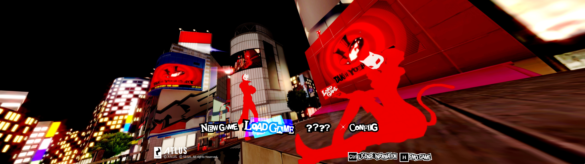
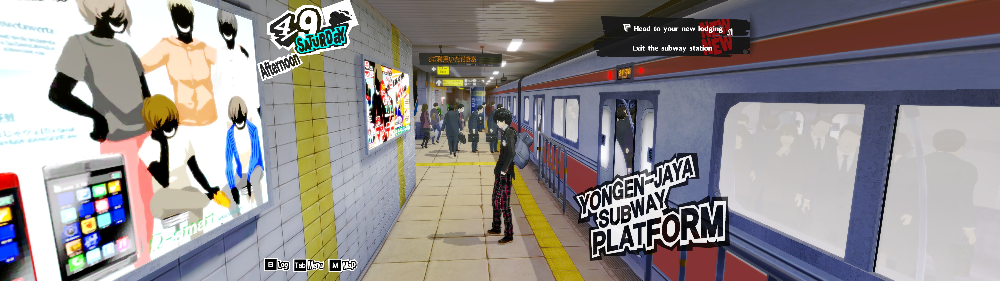
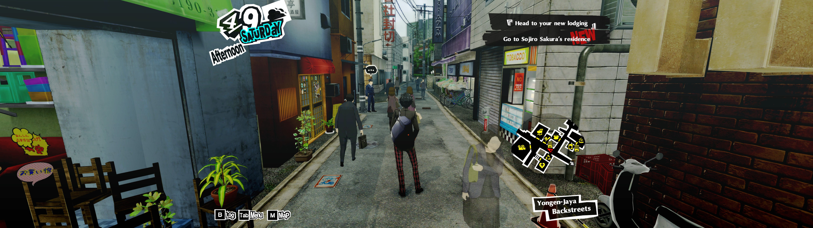
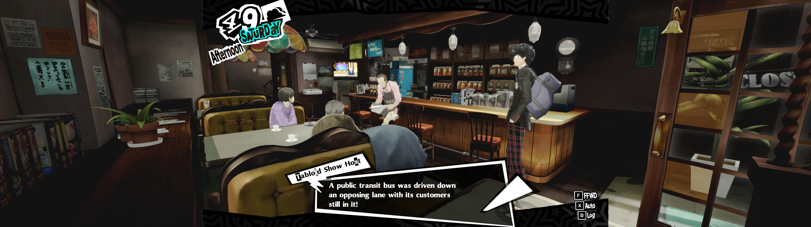
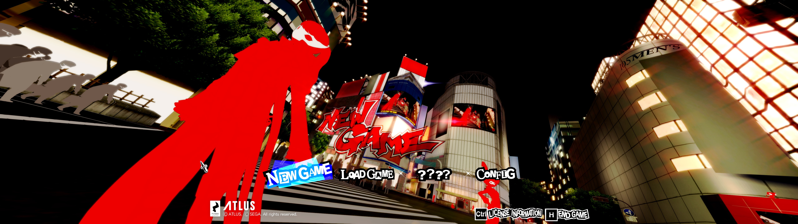
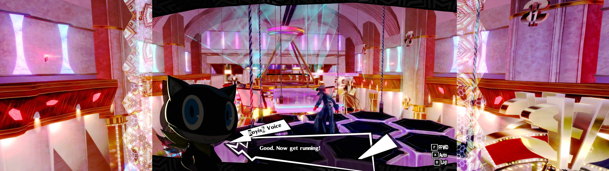
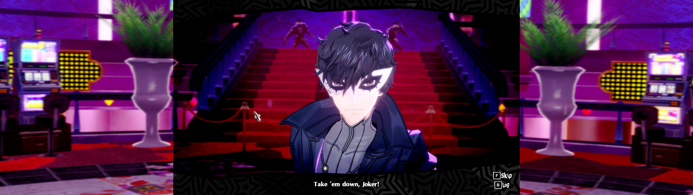
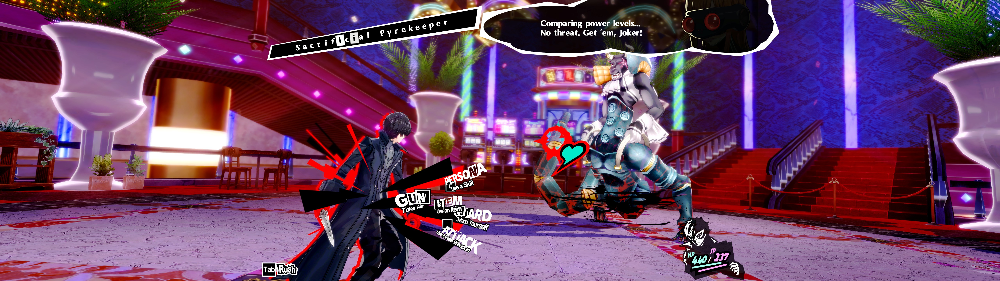

# Persona 5 Royal Ultrawide Patch (with centered UI / HUD)

## Features
- Supports 21:9 and 32:9 aspect ratios
- Increases FoV in FoV-limited scenes
- Centers UI / HUD

## Prerequisites
- Steam version of Persona 5 Royal (Game Pass version currently not supported)

## Installation
- Launch the game once and initially set resolution / window mode
- Download newest Release [here](https://github.com/nick-fetcko/Persona5Ultrawide/releases/latest/download/P5RUltrawide.zip)
- Unzip contents into the P5R folder (typically in `C:/Program Files (x86)/Steam/steamapps/common/P5R`), right alongside `P5R.exe`
- Launch the game
- A console window should open before the game itself does

## Screenshots
### Main Menu

### Yongen-Jaya Subway Station

### Yongen-Jaya Backstreents

### Leblanc

## Known Issues
### Cursor is misaligned in certain menus

### Dialog and palaces have vignettes

### These vignettes look pretty silly in ultrawide

### Certain battle UI elements are misaligned
